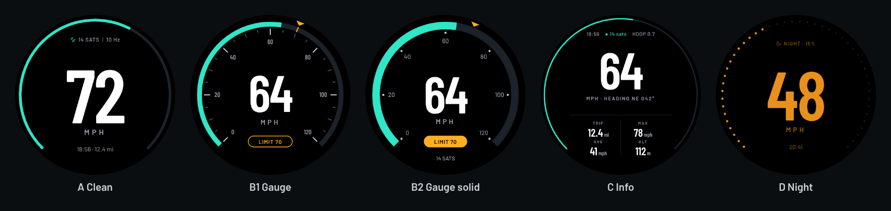
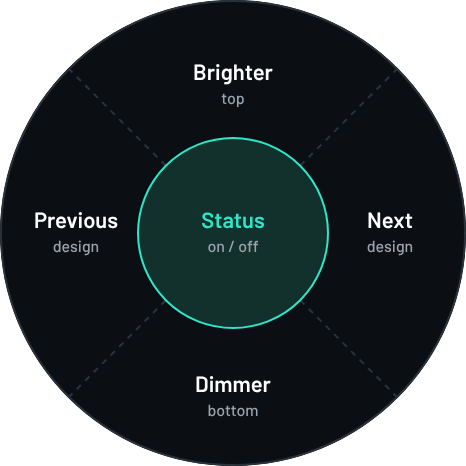
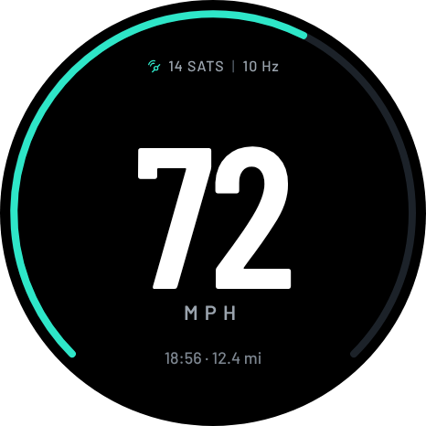
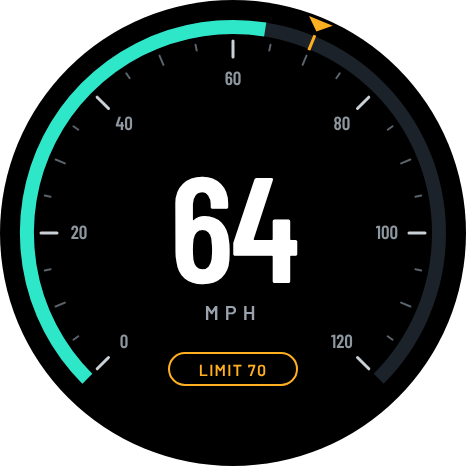
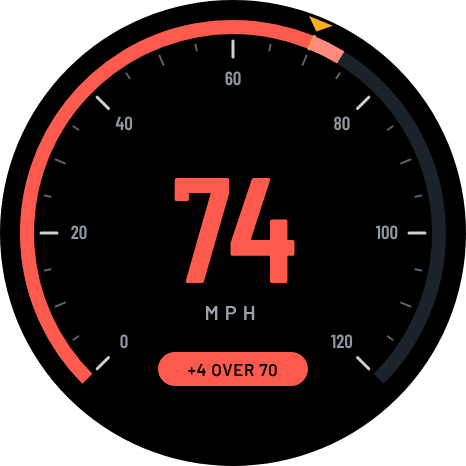
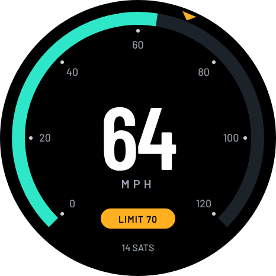
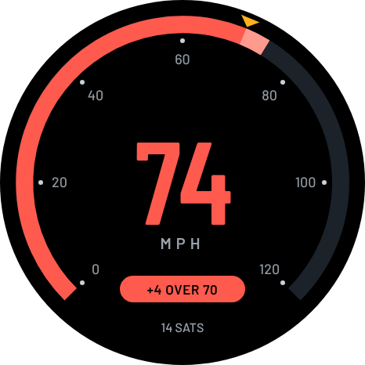
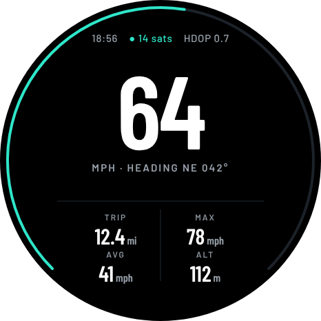
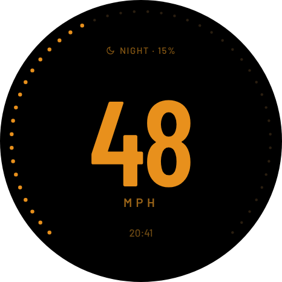

# EX30 GPS Speedometer



A dashboard speedometer for the Volvo EX30, built on the **M5Stack StopWatch** (ESP32-S3, 1.75" round 466 x 466 AMOLED) with the **M5Stack GPS/BDS Unit v1.1 (AT6668)** plugged into the side port.

- Five designs, in this order: **A** Clean, **B1** Gauge, **B2** Gauge solid, **C** Info, **D** Night (warm colours, few pixels lit). Step through them with the touch screen or Key A. With *Auto night* on, D comes on after dark by itself.
- Every element's colour can be changed, from the web page (any colour) or on the device (presets).
- Speed in **mph** by default (km/h in settings), whole numbers only, smoothed but accurate.
- GPS runs at **10 Hz** (1 / 5 / 10 selectable).
- Brightness steps down from day to night based on the sun's position, worked out from GPS position and time (the StopWatch has no light sensor).
- Wi-Fi: joins your phone hotspot (or any saved network, up to 5) and pushes location and speed to your own API.

## Build and flash (VS Code + PlatformIO)

1. Install VS Code and the **PlatformIO IDE** extension (the project recommends it when opened).
2. *File > Open Folder* and pick this folder. PlatformIO downloads the toolchain and libraries on first build.
3. Plug in the StopWatch with USB-C and press **Upload** (the arrow on the status bar), or run `pio run -t upload`.
4. *Serial Monitor* is at 115200 baud.


Library versions are pinned in `platformio.ini` to the commits this was built against.

## Wiring

GPS unit to the StopWatch side port (HY2.0-4P) with the supplied cable: black GND, red 5 V, yellow G10, white G11.
The firmware probes both pin orientations and 115200 / 9600 baud at start-up, so it works whichever way round the TX/RX lines are. It then:

- switches the receiver to 115200 baud if needed (`$PCAS01,5`)
- sends only GGA and RMC sentences (`$PCAS03`) to keep the link light
- sets the update rate (`$PCAS02,100` = 10 Hz)
- selects the automotive dynamic model (`$PCAS11,3`)

The 5 V on the port is switched on through the power chip at boot (`M5.Power.setExtOutput(true)`).

## Touch zones

The round screen is split into five zones:



- **Centre** (the middle circle, about a third of the screen): status page on / off
- **Top**: brightness one step up. **Bottom**: one step down. This moves you up or down from the automatic level, and resets when you choose Auto again with Key B
- **Right**: next design. **Left**: previous design (A, B1, B2, C, D, then round again)

Each tap gives a short buzz. At night with *Auto night* on, changing design is temporary: it goes back to D the next night, and to your daytime design in the morning.

## Buttons

| Key | Action | What it does |
|---|---|---|
| A | Press | Next design |
| A | Hold 1 s | Reset trip, max and average |
| A | Double press | Status page: GPS, rate, Wi-Fi, IP address, API queue, sun angle, trip, battery |
| B | Press | Brightness nudge: Auto, +1, -1, -2 steps |
| B | Hold 1 s | Settings menu |
| A + B | Hold 2 s | Set the speed alert to your current speed, rounded to 10. Do it while stopped to switch the alert off |

In the settings menu: **A** next item, **B** change value, **hold B** to save and exit.

Settings: units, design, auto night, day colours, night colours, brightness (auto or fixed), GPS rate, smoothing, speed alert (off / vibrate / vibrate and tone), alert limit, Wi-Fi on/off, Wi-Fi setup, send to API, reset trip.

## Designs

A, B and C share the day colours; D has its own. Colours you can change: background, speed digits, units label, ring (lit and unlit), status text and icon, bottom line, over-limit colour, and for B the major ticks, minor ticks, dial numbers and limit marker. Over the alert limit, the speed and ring turn the over-limit colour.

The pictures are mock-ups in the default colours (`tools/render_designs.py` draws them); the firmware draws the same layouts on the 466 x 466 screen.

| | |
|---|---|
|  | **A Clean** - very large speed, thin ring, satellites and GPS rate, clock and trip. |
|  | **B1 Gauge** - 0 to 120 mph dial (0 to 200 km/h) with ticks, limit marker and outlined limit label. With no limit set, the label shows the clock and trip. |
|  | **B1 over the limit** - speed and ring turn red, with "+4 OVER 70". |
|  | **B2 Gauge solid** - thicker ring, dot ticks, solid limit label. |
|  | **B2 over the limit** - the part of the ring above the limit is highlighted. |
|  | **C Info** - speed, heading, trip, max, average, altitude, satellites and HDOP. |
|  | **D Night** - warm colours on black, dotted ring, minimal pixels lit. Comes on by itself after dark with *Auto night*. |

## Brightness

| Sun elevation | Step | Brightness |
|---|---|---|
| above 6 deg | Day | 100% |
| 0 to 6 deg | Low sun | 75% |
| 0 to -6 deg | Dusk (civil twilight) | 50% |
| -6 to -12 deg | Twilight (nautical) | 30% |
| below -12 deg | Night | 15% |

Changes fade over about 5 seconds. Before the first GPS fix it uses the StopWatch's real-time clock and the last known position. With *Auto night* on, design D comes on when the sun is below -3 deg; you can change that angle on the web page.

## Speed smoothing

- Speed comes from the receiver's Doppler measurement (RMC), which is more accurate than working it out from position changes.
- Adaptive smoothing: steady speeds are smoothed, real acceleration passes through quickly. Low / medium / high in settings.
- The whole number only changes once the speed is clearly past it (0.6 of a unit), so it does not flicker between two values.
- Standstill: the accelerometer tells when the car is still, so the display reads 0 instead of drifting at 1 to 2 mph.

## Wi-Fi and the web page

The StopWatch keeps two networks:

- **Network 1 - phone hotspot**, for travelling (sending location and speed)
- **Network 2 - home Wi-Fi**, for firmware updates and changing settings at home

When both are in range it uses home (you can turn that off). It only works with 2.4 GHz Wi-Fi: on an iPhone, turn on **Maximise Compatibility** in Personal Hotspot.

An iPhone cannot run its hotspot and join another Wi-Fi network at the same time, so enter the details in one of these ways:

1. **At home, on the settings page (easiest).** Hold Key B, choose *Wi-Fi setup*, press B. Turn the iPhone hotspot off, scan the QR code on the StopWatch, and the settings page opens (or browse to http://192.168.4.1). Type the names and passwords for Network 1 and Network 2, or tap *Scan for networks* and *Use as 1* / *Use as 2* to fill in the name. Save each, then hold B on the StopWatch to close setup. Turn the hotspot back on and it connects.
2. **In the code.** Copy `include/secrets_example.h` to `include/secrets.h`, fill in both networks and an OTA password, and upload. Those fill any empty slots on start-up. See *Secrets* below.
3. **Over USB.** Open the PlatformIO serial monitor (115200) and type:
   ```
   wifi1 "Mark's iPhone" "hotspot-password"
   wifi2 "Home-WiFi" "home-password"
   status
   ```
   `clear1`, `clear2`, `ota "new-password"` and `reboot` also work. iPhone hotspot names often use a curly apostrophe, so if it will not connect, use the scan on the web page to copy the exact name.

Once connected, the settings page is at **http://ex30-speedo.local** (or the IP address on the status page). From there you can change both networks, every colour (with a live preview), units, designs, brightness, GPS rate, alerts, the API address and the time zone. A blank password field keeps the saved password.

## Firmware updates over Wi-Fi

With the StopWatch and your PC on the same network (normally home, Network 2):

- **From PlatformIO:** pick the `ota` environment in the PlatformIO toolbar and press Upload. It sends to `ex30-speedo.local` with the password from `secrets.ini` (see *Secrets* below). If Windows cannot find that name, set `host` in `secrets.ini` to the IP address shown on the status page.
- **From a browser:** open http://ex30-speedo.local/update (user `admin`, OTA password) and upload `.pio/build/m5stack-stopwatch/firmware.bin`.

The screen shows progress, then the StopWatch restarts. The default OTA password is `speedo1234`; change it on the web page (6+ characters) or in `include/secrets.h`, and put the same password in `secrets.ini`.

## Secrets

Passwords stay out of git. Two files hold them, both listed in `.gitignore`, each with an example to copy:

| Copy this | To this | What it holds |
|---|---|---|
| `include/secrets_example.h` | `include/secrets.h` | Network 1 and 2 names and passwords, OTA password. Compiled into the firmware; only fills empty settings on first start |
| `secrets_example.ini` | `secrets.ini` | OTA password and address used by the PlatformIO `ota` upload |

Both are optional: the project builds without them, and the networks can be set from the web page or USB instead.

## Remote API

When *Send to API* is on, a point is recorded every 5 s (configurable) while there is a GPS fix. Points are queued in PSRAM (up to about 4,000, roughly 5.5 hours) and sent every 10 s whenever Wi-Fi is up, so nothing is lost in signal gaps. Failed sends back off and retry.

`POST <API URL>` with `Content-Type: application/json` and, if set, `Authorization: Bearer <token>`:

```json
{
  "device": "ex30-speedo-1A2B",
  "points": [
    {"t": "2026-11-01T18:56:05Z", "lat": 51.401234, "lon": -1.323456,
     "speed_mph": 41.3, "speed_kmh": 66.5, "heading": 87, "alt_m": 112,
     "sats": 14, "hdop": 0.7}
  ]
}
```

Any 2xx response counts as delivered and removes those points from the queue. Batches hold up to 50 points.

HTTPS is supported, but the server certificate is not checked (`setInsecure()`), which keeps it simple for a hobby API. Use the bearer token to protect the endpoint.

To try it before writing the real API, run `python tools/test_api_server.py 8080` on a laptop on the same hotspot and set the URL to `http://<laptop-ip>:8080/points`.

## Project layout

```
platformio.ini          board, flash/PSRAM settings, libraries
src/main.cpp            main loop, buttons, settings menu, alerts, trip, time
src/gps.*               AT6668 detection and CASIC configuration, NMEA parsing
src/speed_filter.*      smoothing, display hysteresis, standstill detection
src/brightness.*        sun position and brightness steps
src/ui.*                designs A and D, settings / status / Wi-Fi setup screens
src/settings.*          saved settings and colour presets
src/net.*, web_page.h   Wi-Fi (two networks), setup hotspot, web page, OTA updates
src/telemetry.*         point queue and upload task
include/fonts_vlw.h     anti-aliased Barlow fonts (generated)
include/secrets_example.h  template for pre-loading networks and OTA password
tools/make_vlw.py       regenerates the fonts: python tools/make_vlw.py tools/fonts include/fonts_vlw.h
tools/test_api_server.py  simple API receiver for testing
tools/render_designs.py   draws the README pictures (docs/images)
secrets_example.ini     template for the PlatformIO OTA password
```

Fonts: Barlow and Barlow Condensed, SIL Open Font License (`tools/fonts/OFL.txt`).

## Not yet tested on the hardware

This builds cleanly but has not been run on a StopWatch yet. Things to check on first power-up:

- the GPS is found (status page shows the RX pin and baud) and the rate reaches about 10 Hz outdoors
- if your unit is one of the batches reported as 7N1 rather than 8N1, tell me and I will add that to the probe
- text and ring positions look right on the real screen; positions are in `src/ui.cpp`
